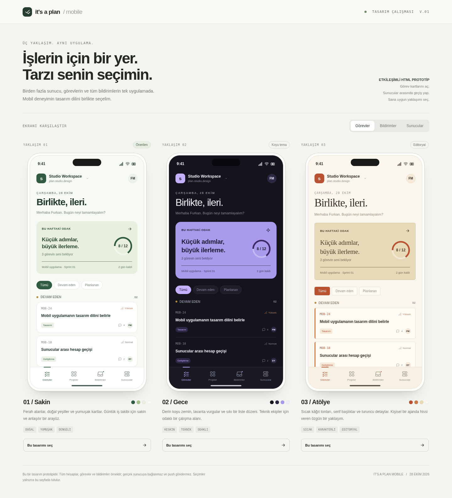

# It's a Plan Mobile

An open-source, multi-server mobile companion for [It's a Plan](https://github.com/croffasia/itsaplan).

**Selected design: 01 / Sakin, with configurable theme colors.** The Expo 58 application uses one `@expo/ui` universal component tree for Android and iOS. Its interactive screens use clearly labeled, in-memory demo data. Real server sign-in and push are not connected.

## Development

Use Node 24. From this checkout:

```sh
npm ci
npm run typecheck
npm test
npm run bundle:android
npm run bundle:ios
npm start
```

See [the mobile foundation and validation guide](docs/mobile-foundation.md) and
[upstream API/auth research](docs/upstream-api-research.md). Theme values are in
`src/theme.ts`. The demo supports account switching, projects, task details,
completion, comments and source-aware inbox navigation.

## Design review

Download [the standalone HTML prototype](design/tasarim-secimi.html) and open it in a browser. It has no external dependencies and works offline.

| Direction | Appearance | Focus |
| --- | --- | --- |
| 01 / Sakin | Light surfaces, green accents, rounded cards | Calm daily task management |
| 02 / Gece | Dark surfaces, lavender accents, compact lists | Focused work for technical teams |
| 03 / Atölye | Cream surfaces, orange accents, serif headings | A warm editorial identity |

Use the top controls to compare tasks, notifications, and servers. Each phone also has its own navigation. Open task cards, switch accounts, add a sample server, or mark sample tasks complete. The selection button only records a choice in the page until reload; it does not submit feedback. The user selected 01 / Sakin. The choice and subsequent decisions are recorded in It’s a Plan project `technowide-software.IPM`.



## Scope

- Android and iOS application with isolated accounts for multiple self-hosted servers.
- Projects, assigned tasks, task details, and comments.
- An inbox that identifies each notification's source server and account.
- A server notification integration and an independently deployable push gateway.

See [the project brief](docs/project-brief.md), [delivery process](CONTRIBUTING.md), and [project tracking](docs/tracking.md).

## CI

`Design preview` packages the standalone HTML and reference screenshot. `Mobile`
runs clean installation, typecheck, isolation tests, Android/iOS bundle exports,
and native Android debug APK/iOS simulator jobs. These jobs require no signing
secrets. Native build results and device verification must be reported separately
from successful JavaScript bundles; see the validation guide for artifact limits.

## License

AGPL-3.0-only. This is an independent companion project and is not an official release of the upstream project. No upstream application code has been copied into this prototype.
